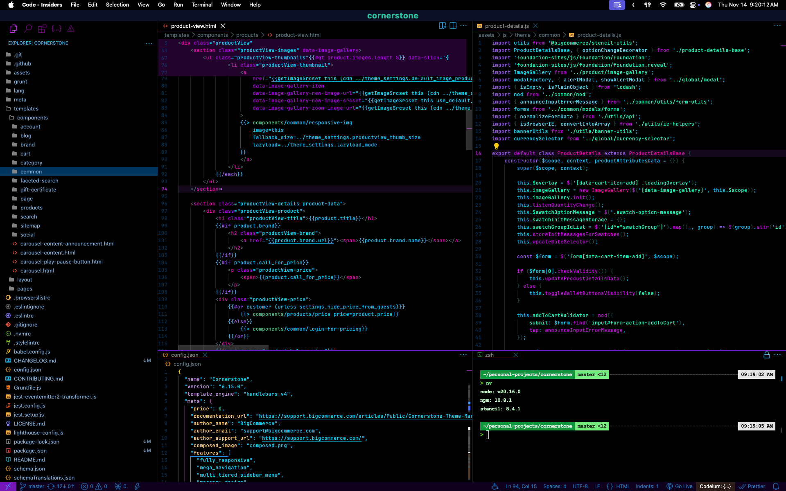

# Neon Future README

# Setup
1. Include these in your settings.json configuration
	- {
		"window.title": "${rootName}",
		"editor.stickyScroll.enabled": true,
		"editor.fontFamily": "Courier New, Menlo, Monaco, 'Courier New', monospace",
		"editor.cursorSmoothCaretAnimation": "on",
		"editor.cursorBlinking": "expand",
		"workbench.iconTheme": "bearded-icons",
		"workbench.activityBar.iconClickBehavior": "toggle",
		"workbench.activityBar.location": "top",
		"window.titleBarStyle": "native",
    	"editor.smoothScrolling": true,
		"vscode_custom_css.imports": ["file:///<path-to-custom-css>/vscode-custom.css"]
	}

2. Install vscode extensions:
	- [Custom CSS and JS Loader](https://marketplace.visualstudio.com/items?itemName=be5invis.vscode-custom-css)
	- (optional) [Bearded Icons](https://marketplace.visualstudio.com/items?itemName=BeardedBear.beardedicons)

3. Custom CSS and JS Loader
	- Use custom css found [here](https://github.com/Dpschu2/Neon-Future/blob/main/vscode-custom.css)

## Working with Markdown

* Split the editor (`Cmd+\` on macOS or `Ctrl+\` on Windows and Linux).
* Toggle preview (`Shift+Cmd+V` on macOS or `Shift+Ctrl+V` on Windows and Linux).
* Press `Ctrl+Space` (Windows, Linux, macOS) to see a list of Markdown snippets.

## For more information

* [Visual Studio Code's Markdown Support](http://code.visualstudio.com/docs/languages/markdown)
* [Markdown Syntax Reference](https://help.github.com/articles/markdown-basics/)

**Enjoy!**